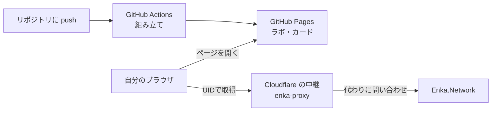

# 保守メモ（聖遺物ラボ・命ノ星座カード）

しばらく触らなかったあとに、「どこに何があって、困ったら何を見ればいいか」を思い出すためのメモ。
最終更新：2026-10-28（命ノ星座カード v1.5）

> Claude に頼むときは「`wayfaringgene-code/genshin-lab` の `MAINTENANCE.md` を読んでから」と伝えると早い。

---

## 1. 全体図：どこに何があるか

| もの | 場所 | 役割 | ログイン |
|---|---|---|---|
| **GitHub リポジトリ** | https://github.com/wayfaringgene-code/genshin-lab | すべての元（ラボのコード・組み立てスクリプト・中継のコード・このメモ）。**正はここ** | Google で続行 |
| **聖遺物ラボ：キャラ** | https://wayfaringgene-code.github.io/genshin-lab/ | 公開ページ。キャラの装備を秘境レベルで並べる | 不要 |
| **命ノ星座カード** | https://wayfaringgene-code.github.io/genshin-lab/card/ | 公開ページ。カード画像を作る。UID・動画・スクショから取り込み | 不要 |
| **Enka 中継（Cloudflare Workers）** | https://enka-proxy.wayfaringgene.workers.dev/uid/{UID} | カードの「UIDで取得」が Enka.Network に問い合わせるための窓口 | Cloudflare（Google で続行） |
| **GitHub Actions** | リポジトリの Actions タブ | push のたびにページを組み立てて公開する係 | — |
| claude.ai の artifact（予備） | 命ノ星座カード：https://claude.ai/artifact/CWeeXV4M4vmh2rh7JRabbP 聖遺物厳選ラボ（全タブ入り）：https://claude.ai/artifact/CyumpKAACPGCbSeY8sFpFA | 自分だけが見られる版。自動では更新されない（下の「artifact 版」） | claude.ai |

外部サービス（自分のものではない）：
- **Enka.Network**：UIDからショーケースのキャラの装備を返してくれるサービス。動いているかは https://status.enka.network/ で確認できる
- **EnkaNetwork/API-docs**（GitHub）：Enka の説明書と、キャラ名・セット名などの元データ

### 動きの流れ

- ページはすべて **見る人のブラウザの中で動く**。GitHub Pages はファイルを置いて見せるだけ
- Enka はよそのページからの直接の呼び出しを許していない（CORS）ので、Cloudflare の中継を間に挟んでいる
- 中継は「UIDで取得」を押した瞬間だけ動く小さな JavaScript（`proxy/enka-proxy.js`）

---

## 2. データはどこに保存されているか

- キャラのデータ・設定は **ブラウザの中（localStorage）**、立ち絵は **ブラウザの中（IndexedDB）**。サーバーには何も送っていない
- 端末・ブラウザごとに別々。**別の端末へ移すときは**、カードアプリの「設定 → データの引っ越し」で書き出して、移した先で読み込む（**立ち絵は引っ越しに入らない**ので、選び直し）
- GitHub Pages では、ラボ（ルート）とカード（`/card/`）が **同じ保存場所を共有** する。カードで取り込んだキャラはラボにも出る
- artifact 版と GitHub 版は **別々の保存場所**（行き来は「データの引っ越し」で）
- ブラウザの「サイトのデータを消去」をするとデータも消える。心配なら、ときどき「データの引っ越し」で書き出して控えを取っておく

---

## 3. よくある作業

### ラボやカードを直したい
1. Claude に頼む（リポジトリ `wayfaringgene-code/genshin-lab` を指定）。自分で直すなら、ラボのコードは `src/lab.html`、カードアプリの差分は `tools/build_card.py`
2. `main` に push されると、GitHub Actions が組み立てて公開する（1分ほど）
3. 反映を確かめる：カードアプリの「設定」タブの一番下の版番号。古いままなら強制再読み込み（Mac：Command+Shift+R／Windows：Ctrl+F5）。GitHub Pages は最大10分ほどキャッシュすることがある

> 以前はラボを artifact で直していたが、**今は `src/lab.html` が正**。artifact だけを直すと GitHub と食い違う。

### 新キャラ・新セットが出た（カードに「不明なキャラ（10000xxx）」と出る）
Enka の対応表を作り直す。Claude に「Enka の対応表を更新して」と頼めばよい。中身は：
1. https://github.com/EnkaNetwork/API-docs を取ってくる
2. `python3 tools/build_enka_tables.py <API-docs のフォルダ> tools/enka_tables.json`
3. commit・push（あとは自動で公開）

動画の読み取り（ビデオスキャナー）の名前データ `src/scanner/data.js` は Genshin Optimizer のデータから作ったもの。**作り直す手順はまだリポジトリに入っていない**（別のスレッドで作成）。新キャラの名前が読めなくなったら、Claude に作り直しを頼む。

### 「UIDで取得」が動かない
上から順に確認する。

| 表示・症状 | 原因と対処 |
|---|---|
| 「ゲームのメンテナンス中か、更新の直後で…」 | Enka 側の都合（424）。時間をおく。https://status.enka.network/ |
| 「問い合わせが混み合っています」 | 呼びすぎ（429）。少し待つ |
| 「このUIDのプレイヤーが見つかりませんでした」 | UIDの打ち間違い（404） |
| 「キャラの詳細が見られませんでした」 | ゲームのプロフィールで、ショーケースにキャラを並べ、詳細を見られるようにする |
| 「このページからは Enka に直接つなげませんでした」 | 中継が動いていない／中継に断られた。下の「中継の確認」へ |
| 「この画面（claude.ai の中）からは…」 | artifact 版では中継も使えない決まり。GitHub 版を使うか、「うまくいかないとき」の貼り付けの手順で |

**中継の確認**
1. ブラウザで https://enka-proxy.wayfaringgene.workers.dev/uid/{自分のUID} を開く。文字だらけのデータが出れば中継は正常
2. 「Error 1027」→ 無料枠（1日10万回）を超えた。日本時間の朝9時に戻る。続くなら誰かに使われている可能性（下の「中継を作り直す」）
3. 何も出ない・別のエラー → Cloudflare のダッシュボード → Workers & Pages → `enka-proxy` を開いて、消えていないか・最後の Deploy が失敗していないかを見る
4. ページを別の場所（独自ドメインなど）に移した → `proxy/enka-proxy.js` の `ALLOW` にその場所を足して、中継を貼り直す（下）

### 中継を直す・作り直す
- 中身を直したとき：`proxy/enka-proxy.js` の中身を、Cloudflare の `enka-proxy` の **Edit code** に全部貼り直して **Deploy**（自動では反映されない）
- 作り直したとき（URL が変わったとき）：`tools/build_card.py` の `ENKA_PROXY` を新しい URL（末尾 `/uid/`）に変えて push
- 置き方の手順は `proxy/README.md`

### 公開が反映されない・失敗した
- リポジトリの **Actions** タブで、最新の「ページを組み立てて公開」が緑（成功）か見る。赤なら中を開いてエラーを Claude に見せる
- Settings → Pages の **Source が「GitHub Actions」** になっているか（「Deploy from a branch」に戻っていると、ルートに何も出なくなる）

### artifact 版も更新したいとき（任意）
artifact は自動では更新されない。Claude に「artifact 版も最新にして」と頼む（`python3 tools/build_card.py src/lab.html <出力>` で組み立てて、上の URL に公開し直す）。

---

## 4. お金とセキュリティ

- **Cloudflare は無料プランのまま使う**。無料プランでは、使い切っても止まるだけで請求は来ない。**有料プラン（Workers Paid）にはアップグレードしない**、支払い方法も登録しない
- GitHub・Cloudflare とも **Google で続行** でログイン。守りは Google アカウント次第（2段階認証・パスキーは有効にしてある）
- Claude の GitHub App は **`genshin-lab` だけ** に書き込める設定。やめたいときは GitHub → Settings → Applications → Installed GitHub Apps → Claude で外す
- リポジトリは **公開**。パスワード・APIキー・自分の Enka の応答データなどは入れない（中継は秘密の情報を使っていない）
- 中継は「Enka の `/api/uid/数字/` だけ」を問い合わせ、受け付けるのは GitHub Pages と手元の確認用（`http://localhost:8000`）だけ

---

## 5. 版の記録（命ノ星座カード）

| 版 | 内容 |
|---|---|
| v1.0 | ラボのコードから単品のカードアプリとして組み立て（artifact） |
| v1.1 | 動画から取り込む（ビデオスキャナー）、育成途中（+0〜+16・未発動のサブOP）の評価 |
| v1.2 | UIDから取り込む（Enka の JSON を貼り付け）、まとめて保存（ZIP） |
| v1.3 | 空の部位の不具合修正、立ち絵の縮小保存、一覧の並び順の切り替え、見えない図の計算を省略 |
| v1.4 | 「UIDで取得」ボタン |
| v1.5 | GitHub Pages に移行、Cloudflare の中継経由で UID から直接取得、ラボとの設定の取り合いを解消 |

## 6. 残っている宿題

- ラボとカードの共通部分の切り出し（コードの二重持ちの解消）。ラボ本体に残っている「空の部位がメインOPつきで保存される」不具合も、そのときに直す
- 立ち絵を「データの引っ越し」に含める
- ビデオスキャナーの名前データ（`src/scanner/data.js`）を作り直す手順をリポジトリに入れる
- 中継に呼び出し回数の制限を入れる（必要になったら。Cloudflare をリポジトリとつなぐ方式への切り替えが要る）
